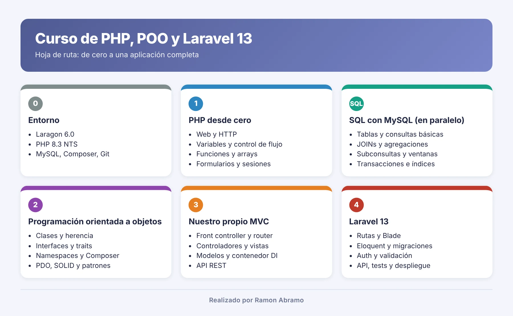

# Curso de Programación Orientada a Objetos con PHP (2026)

<p align="center"></p>

¡Bienvenidos y bienvenidas! 👋 Este repositorio es vuestro punto de partida: aquí iréis encontrando, clase a clase, la teoría, los ejemplos y los ejercicios del curso, desde lo más básico de la programación web hasta desarrollar aplicaciones completas con **Laravel**.

---

##  Presentación

Buenas, soy **Ramón Abramo**, profesor con más de 25 años de experiencia docente, y voy a acompañaros durante todo el curso.

No necesitáis saber programar. Empezaremos desde cero: qué es la programación web, qué hace cada tecnología, cómo se monta un entorno de trabajo… y solo entonces escribiremos nuestras primeras líneas de PHP. A partir de ahí iremos subiendo el nivel poco a poco, siempre con ejemplos pequeños que podréis escribir, probar y modificar vosotros mismos.

Mi forma de trabajar es sencilla: primero entender, luego practicar. Y preguntar todo lo que haga falta. 🙂

---

##  Objetivo del curso

Al terminar el curso seréis capaces de:

1. 🌐 **Entender cómo funciona la web**: cliente, servidor, frontend, backend y el papel de cada tecnología.
2. 🛠️ **Montar vuestro propio entorno de desarrollo** con Laragon y Visual Studio Code.
3. 🐘 **Programar en PHP**: variables, condiciones, bucles, arrays, funciones y formularios.
4. 🐬 **Trabajar con bases de datos MySQL** usando SQL y conectarlas con PHP.
5. 🧱 **Programar con orientación a objetos**: clases, objetos, herencia, interfaces y buenas prácticas.
6. 🏗️ **Entender cómo funciona un framework** construyendo nuestro propio MVC.
7. 🚀 **Desarrollar aplicaciones web completas con Laravel**.

---

##  Esquema general del curso



### Primeras clases

| Clase | Tema | Contenido |
|---|---|---|
| **1** | [🌍 El mundo de la programación hoy](clase-01-mundo-programacion/README.md) | Programación web y de escritorio, cliente y servidor, frontend, backend y fullstack, HTML, CSS, JavaScript, PHP y MySQL. **Solo teoría** |
| **2** | [🛠️ Entorno de desarrollo con Laragon](clase-02-entorno-laragon/README.md) | Instalación de Laragon 6, cambio de versión de PHP (NTS) y MySQL, carpeta raíz y virtual hosts automáticos |
| **3** | [🧩 Visual Studio Code y sus extensiones](clase-03-visual-studio-code/README.md) | Extensiones para PHP, HTML, CSS, JavaScript y Laravel, ajustes y atajos |
| **4 a 6** | [🐘 Primeros pasos con PHP](clase-04-primeros-pasos-php/README.md) | Ejemplos de introducción: phpinfo, sintaxis, variables, operadores, condicionales, bucles, arrays, funciones, formularios, errores y primera conexión con MySQL |

### PHP paso a paso

| Clase | Tema | Contenido |
|---|---|---|
| **7** | [🔢 Datos y operadores, ahora con calma](clase-07-datos-y-operadores/README.md) | Tipos, comillas, constantes, conversiones, `===`, `??`, ternario y formato de números |
| **8** | [🔀 Decidir y repetir](clase-08-decidir-y-repetir/README.md) | Pseudocódigo, `if` sin anidar, `match`, qué bucle elegir, contador, acumulador y máximo |
| **9** | [🧰 Funciones](clase-09-funciones/README.md) | `echo` frente a `return`, parámetros, argumentos con nombre, tipos, `strict_types` y ámbito |
| **10** | [🗂️ Arrays y textos](clase-10-arrays-y-textos/README.md) | Arrays asociativos y tablas de datos, ordenar, `array_map`, textos con tildes, validar y fechas |
| **11** | [📝 Formularios, archivos y ficheros](clase-11-formularios-archivos/README.md) | Validar y escapar, XSS, ficheros JSON, *Post/Redirect/Get* y subida de archivos |
| **12** | [🔐 Sesiones, login y seguridad](clase-12-sesiones-seguridad/README.md) | Cookies y sesiones, contraseñas cifradas, login completo, XSS, inyección SQL y CSRF |
| **13** | [🧩 Organizar el código y controlar los errores](clase-13-organizar-codigo-errores/README.md) | `require_once`, cabecera y pie comunes, leer errores, depurar y excepciones |

### Bases de datos con PHP

| Clase | Tema | Contenido |
|---|---|---|
| **14** | [🐬 Bases de datos con PDO](clase-14-bases-datos-pdo/README.md) | Conexión con PDO, consultas preparadas, inyección SQL, `INSERT`, `UPDATE`, `DELETE` y transacciones |
| **15** | [🛠️ Proyecto CRUD paso a paso](clase-15-proyecto-crud/README.md) | Catálogo de cursos completo: listado con buscador y paginación, alta, edición, borrado seguro y login |

### Programación orientada a objetos

| Clase | Tema | Contenido |
|---|---|---|
| **16** | [🧱 Clases y objetos](clase-16-clases-y-objetos/README.md) | Clase y objeto, métodos y `$this`, constructor, encapsulación, `readonly`, `static` y una clase por archivo |
| **17** | [🌳 Herencia, interfaces y polimorfismo](clase-17-herencia-interfaces/README.md) | `extends`, `parent::`, clases abstractas, `final`, interfaces, polimorfismo y traits |
| **18** | [✨ PHP moderno y POO avanzada](clase-18-php-moderno/README.md) | `?tipo` y tipos unión, `?->`, enums, clases `readonly`, `__toString`, `clone` y excepciones propias |
| **19** | [📦 Namespaces, Composer y autocarga](clase-19-namespaces-composer/README.md) | Namespaces y `use`, autocarga, PSR-4, Composer e instalación de librerías como Carbon |
| **20** | [🗄️ Bases de datos con objetos](clase-20-bases-datos-objetos/README.md) | El CRUD rehecho con una clase de conexión, entidades, repositorios y excepciones propias |
| **21** | [🧹 Calidad y buenas prácticas](clase-21-calidad-buenas-practicas/README.md) | Nombres, funciones cortas, PSR-12, errores globales, inyección de dependencias, SOLID y herramientas |

### Nuestro propio MVC

| Clase | Tema | Contenido |
|---|---|---|
| **22** | [🏗️ Arquitectura MVC y front controller](clase-22-mvc-front-controller/README.md) | MVC, una sola puerta de entrada (`public/index.php`), `.htaccess`, controlador, vistas con layout y el modelo de la clase 20 |
| **23** | [🧭 Router, peticiones y respuestas](clase-23-router-peticiones/README.md) | Clases `Peticion` y `Respuesta`, un router con parámetros (`/cursos/{id}`), errores 404, 405 y 500 |
| **24** | [🧩 Controladores, vistas y modelos](clase-24-controladores-vistas-modelos/README.md) | `.env` propio, modelo base al estilo de Eloquent, vistas parciales, controlador base, excepciones HTTP y el CRUD completo |
| **25** | [⚙️ Servicios del framework](clase-25-servicios-framework/README.md) | Contenedor de dependencias con *autowiring*, middleware, validación con reglas, mensajes *flash*, autenticación y la comparativa con Laravel |
| **26** | [🔌 APIs REST con PHP puro](clase-26-api-rest/README.md) | API REST de cursos en JSON, verbos y códigos de estado, token `Bearer`, errores en JSON y cliente cURL |

### Laravel

| Clase | Tema | Contenido |
|---|---|---|
| **27** | [🚀 Primeros pasos con Laravel](clase-27-laravel-primeros-pasos/README.md) | Instalación, estructura del proyecto, ciclo de vida de una petición, `.env` y `config()`, primeras rutas y vistas, Artisan y Vite |
| **28** | [🧭 Rutas y controladores](clase-28-laravel-rutas-controladores/README.md) | Rutas con parámetros, restricciones, nombres y grupos; controladores, `Request`, controladores de recurso, *route model binding*, rutas de la API y comandos de consola |
| **29** | [🎨 Vistas con Blade](clase-29-laravel-blade/README.md) | Directivas de Blade, `$loop`, *layouts* con `@extends` y `@yield`, pilas, `@include`, componentes con `@props` y `$slot`, paso de datos y Vite |
| **30** | [🗃️ Base de datos: migraciones, seeders y factories](clase-30-laravel-base-datos/README.md) | Conexión a MySQL, migraciones y claves foráneas, modificar tablas, *factories* con Faker, *seeders* y el Query Builder |
| **31** | [🧬 Eloquent ORM](clase-31-laravel-eloquent/README.md) | Modelos y convenciones, CRUD, relaciones 1:1, 1:N y N:M, carga ansiosa y N+1, *scopes*, *casts*, *accessors* y *mutators*, borrado lógico y paginación |
| **32** | [📝 Formularios y validación](clase-32-laravel-formularios-validacion/README.md) | Protección CSRF, `validate()`, `old()` y `@error`, mensajes en español, *Form Requests*, el CRUD de cursos con `@method`, mensajes *flash* y subida de imágenes |
| **33** | [🔐 Autenticación y autorización](clase-33-laravel-autenticacion/README.md) | Login, registro y *logout* con `Auth`, middleware `auth`, `guest` y `throttle`, *starter kits*, roles con un enum, *gates* y *policies* |
| **34** | [⚙️ Arquitectura interna de Laravel](clase-34-laravel-arquitectura/README.md) | Servicios, contenedor con `bind` y `singleton`, *service providers* y *view composers*, contratos, *facades* propias, middleware con parámetros y la comparativa final con nuestro MVC |
| **35** | [🔌 API REST con Laravel](clase-35-laravel-api-rest/README.md) | API versionada con `apiResource`, *API Resources*, paginación y filtros, tokens con Sanctum, permisos con las *policies*, errores en JSON y documentación |
| **36** | [🧪 Pruebas](clase-36-laravel-pruebas/README.md) | PHPUnit y `php artisan test`, pruebas unitarias y de funcionalidad, base de datos de pruebas, *factories* y estados, `actingAs`, *fakes* y pruebas de la API |
| **37** | [🚀 Funcionalidades avanzadas](clase-37-laravel-avanzado/README.md) | Eventos y *listeners*, correo con *Mailables*, colas y *jobs*, notificaciones por correo y base de datos, caché, tareas programadas, logs y excepciones propias |

### Lo que viene después

A partir de aquí iremos añadiendo clases. Este es el recorrido previsto (en el temario veréis marcado con ⭐ lo que es «para saber más»):

| Parte | Contenido |
|---|---|
| 🐬 **SQL con MySQL** (en paralelo) | Diseño de tablas, consultas, funciones, agrupaciones y JOINs; como ampliación, subconsultas, transacciones e índices |
| 🚀 **Laravel** | Rutas, Blade, migraciones, Eloquent, validación, autenticación, API, pruebas y despliegue |

Consultad el **[temario detallado](TEMARIO.md)** para ver el contenido de cada bloque.

> 📌 El temario puede ajustarse según el ritmo del grupo.

---

##  Estructura del repositorio

```text
cursoPoo2026/
├── README.md                        ← Estás aquí: presentación y esquema del curso
├── TEMARIO.md                       ← Temario detallado
├── img/                             ← Imágenes comunes
├── clase-01-mundo-programacion/     ← Clase 1: teoría de introducción
├── clase-02-entorno-laragon/        ← Clase 2: instalación y configuración de Laragon
├── clase-03-visual-studio-code/     ← Clase 3: VS Code y extensiones
├── clase-04-primeros-pasos-php/     ← Clases 4 a 6: ejemplos de introducción a PHP
│   └── ejemplos/                    ← Todos los ejemplos, numerados en orden
├── clase-07-datos-y-operadores/     ← Clases 7 a 13: PHP paso a paso
│   ├── ejemplos/                    ← Los ejemplos de la explicación
│   └── soluciones/                  ← Una solución de cada ejercicio
├── clase-08-decidir-y-repetir/
├── ...
├── clase-13-organizar-codigo-errores/
├── clase-14-bases-datos-pdo/        ← Clase 14: bases de datos con PDO
├── clase-15-proyecto-crud/          ← Clase 15: proyecto CRUD (carpeta proyecto/)
├── clase-16-clases-y-objetos/       ← Clase 16: primera clase de POO
├── clase-17-herencia-interfaces/    ← Clase 17: herencia, interfaces y polimorfismo
├── clase-18-php-moderno/           ← Clase 18: PHP moderno y POO avanzada
├── clase-19-namespaces-composer/   ← Clase 19: namespaces, Composer y autocarga
├── clase-20-bases-datos-objetos/   ← Clase 20: el CRUD con objetos (carpeta proyecto/)
├── clase-21-calidad-buenas-practicas/ ← Clase 21: calidad y buenas prácticas
├── clase-22-mvc-front-controller/  ← Clases 22 a 26: nuestro propio MVC (carpeta proyecto/)
├── clase-23-router-peticiones/
├── clase-24-controladores-vistas-modelos/
├── clase-25-servicios-framework/
├── clase-26-api-rest/
├── clase-27-laravel-primeros-pasos/ ← Clases 27 a 38: Laravel (carpetas ejemplos/ con las rutas del proyecto)
├── clase-28-laravel-rutas-controladores/
├── clase-29-laravel-blade/
├── clase-30-laravel-base-datos/
├── clase-31-laravel-eloquent/
├── clase-32-laravel-formularios-validacion/
├── clase-33-laravel-autenticacion/
├── clase-34-laravel-arquitectura/
├── clase-35-laravel-api-rest/
├── clase-36-laravel-pruebas/
├── clase-37-laravel-avanzado/
└── ...                              ← Se irán añadiendo carpetas con cada clase
```

Cada carpeta tiene su propio `README.md` con la explicación de la clase y los mismos apuntes en **PDF** (📕), listos para descargar, imprimir o leer en la tableta.

---

##  Qué vais a necesitar

No instaléis nada todavía: lo haremos juntos en la clase 2 y en la clase 3. Solo para que lo tengáis en el radar:

- 💻 Un ordenador con **Windows 10 u 11**.
- 🛠️ **Laragon 6.0**, que nos dará Apache, PHP y MySQL.
- 🧩 **Visual Studio Code** como editor.
- 🌐 Un navegador moderno: Chrome, Firefox o Edge.
- 🔀 Más adelante, **Git** para descargar el material y **Node.js** para Laravel.

---

##  Cómo trabajar durante el curso

- ⌨️ **Escribid el código vosotros**, no copiéis y peguéis: así es como se aprende.
- 🔧 **Modificad los ejemplos**, rompedlos y arregladlos. Es la mejor forma de entenderlos.
- 🙋 **Preguntad** cualquier duda, por básica que parezca.
- 🔁 **Repasad** la clase anterior antes de empezar la siguiente: cada una se apoya en lo que ya sabéis.

¡Empezamos! 👉 [Clase 1 · El mundo de la programación hoy](clase-01-mundo-programacion/README.md)

---

### Fuentes y Documentación Oficial

En esta presentación no he utilizado fuentes técnicas externas; cada clase incluye al final su propia documentación oficial.
